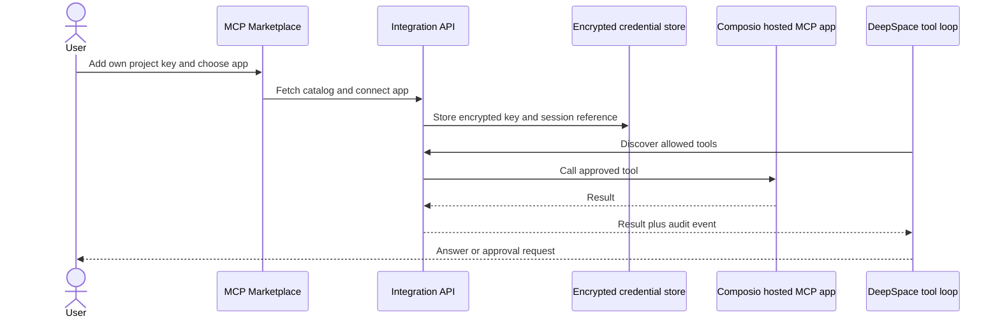

# 06. MCP connections audit

## 1. What it does

1. Browses Composio's live app and tool catalog and discovers tools for connected apps.
2. Uses each account's Composio project key to create its own hosted app sessions.
3. Encrypts stored credentials and enforces tenant/user ownership.
4. Requires policy and approval controls before side-effecting actions.
5. Merges connected tools into the provider-independent DeepSpace loop.



| Public use case | What the user gets | Required protection |
| --- | --- | --- |
| Connect an app from the catalog | Discoverable tools in DeepSpace | User-owned encrypted Composio key and session |
| Ask DeepSpace to read connected data | Provider-independent tool result | Tenant and user ownership checks |
| Ask for a side-effecting action | Approval prompt before execution | Policy gate and audit event |

## 2. Existing exact implementation

1. API and marketplace: `backend/app/integrations/api/mcp.py`.
2. Bridge/runtime: `backend/app/deepspace/services/mcp_bridge.py`.
3. Encrypted credentials and OAuth: `backend/app/integrations/services/` and
   `backend/app/integrations/models/`.
4. Frontend connection and policy UI: `frontend/app/dashboard/mcp/`.
5. Catalog refresh workers: `backend/app/integrations/workers/tasks_mcp*.py`.

## 3. Execution flow

1. Each user saves their own Composio project key under Providers → MCP.
2. The Marketplace fetches Composio's live app catalog; the user selects an app.
3. Composio authorization is completed when that app requires it.
4. AverQel stores an encrypted hosted-session reference scoped to the user's tenant and account.
5. Tool discovery is filtered by connection and policy.
6. DeepSpace requests approval before a side-effecting action.
7. The bridge records the result and audit event.

## 4.1 DeepSpace catalogue protection

The MCP connection layer and the DeepSpace model boundary are intentionally
separate. `DeepSpaceMCPBridge` discovers only tenant/user-owned, enabled,
connected, policy-enabled servers. The DeepSpace broker then keeps those
catalogue entries backend-only and gives the selected model a small deferred
interface:

```text
DeepSpace model
    │ mcp_search_tools(query)
    ▼
Private broker index ──► compact tool_ref matches
    │ mcp_get_tool_schema(tool_ref)
    ▼
One bounded schema hint
    │ mcp_call_tool(tool_ref, arguments)
    ▼
Existing MCP bridge ──► policy/approval/catalog revision/transport/audit
```

Only the minimum metadata for the current request crosses the model boundary.
The broker never forwards all server tools, all JSON schemas, OAuth material,
or transport configuration. A result larger than the configured MCP result
budget is returned as a bounded preview with an explicit truncation marker.

This design applies to all connected MCP apps and future catalog entries. It
does not add a second OAuth client, connection store, remote proxy, or
authorization system. The existing connection-scope APIs remain unchanged:

- `GET /api/v1/mcp/conversations/{conversation_id}/connections`
- `PUT /api/v1/mcp/conversations/{conversation_id}/connections/{server_id}`
- `POST /api/v1/deepspace/chats/{conversation_id}/approvals/{approval_id}`

The implementation is covered by
`backend/tests/unit/test_mcp_tool_broker.py`, the existing bridge tests, and
the DeepSpace chat-loop tests. Broker exposure is mandatory; there is no
legacy full-catalogue fallback. Per-turn discovery, remote-call, and aggregate
result budgets are emitted in DeepSpace metrics for operational monitoring.

## 4. What users see

1. Composio's current app catalog appears in the MCP Marketplace.
2. Users can inspect tools, change policy, connect, refresh, or disconnect.
3. Side-effecting calls display an approval prompt before execution.

## 5. Security and production state

1. Arbitrary user-entered endpoints are not supported. Marketplace apps come
   from Composio's live catalog and availability depends on the user's project.
2. Tenant/user ownership checks protect servers, tools, and tokens.
3. Each user must supply their own Composio key; there is no shared platform
   key for the hosted app catalog.
4. OAuth apps require the deployment's public AverQel callback origin. A
   source-level implementation does not prove that the origin, provider
   availability, migrations, or outbound network are ready in a deployment.

## 6. Verification

1. Existing MCP connection, policy, OAuth, marketplace, and tool-loop tests
   remain part of the full regression suite.
2. The six-capability implementation does not weaken or bypass those controls.

## 7. Composio-hosted app catalog

The Marketplace displays Composio's live app and tool catalog instead of
AverQel's eight bundled Google, GitHub, Notion, and Slack connector cards. The
catalog is fetched on demand and paginated; its total changes with Composio's
catalog. Existing installed connections are retained, and this change does not
delete their records. See the detailed [Composio setup and data-flow guide](mcp/03-composio-hosted-mcp.md).

Each user enters their own Composio project API key under Providers → MCP.
AverQel validates the key, encrypts it with the connector-secret backend, and
binds its associated data and database row-level security to the user's tenant
and account IDs. The authenticated account alone can read, replace, or remove
its key through the MCP credential routes. The server decrypts the key for
Composio requests; it is not end-to-end encrypted from the running server.
There is no shared platform Composio key or admin key-management route.

For OAuth apps, the deployment operator configures AverQel's public HTTPS
origin (`AVERQEL_PUBLIC_ORIGIN`). Users do not configure a Composio callback
verifier. Composio returns the browser to AverQel with the connected-account
ID; AverQel checks it against the pending request stored for the signed-in
user, then confirms the account is active and belongs to the requested toolkit
through that user's own Composio key. A different AverQel account cannot claim
the connection, and callback parameters alone are not accepted as proof.

Each app receives its own hosted MCP session for that toolkit. The session ID
is encrypted with tenant, user, and server IDs as associated data. The MCP
endpoint must use the expected Composio host and approved HTTPS transport;
session headers stay server-side. Composio and the connected app provider
process the authorization, tool inputs, and results.

The standard MCP worker discovers each connected app's live tools, and the
DeepSpace bridge exposes them through its private broker. DeepSpace gets
bounded tool references and requests an individual schema when needed; it does
not receive the complete Composio catalog or credentials. Reads may run under
the new connection's default policy. Writes, deletions, and external messages
require the existing approval flow before execution, even when a user's tool
mode is set to Always allow. Unknown tool names default to write risk. Users
can lower the risk ceiling or block individual tools in the MCP Inspector.

For setup, required callback-origin configuration, provider data handling, and live
deployment checks, see
[`03-composio-hosted-mcp.md`](mcp/03-composio-hosted-mcp.md). A source-level
implementation does not prove that a Composio key, public callback route, database
migration, network route, or live app authorization has been configured for a
specific deployment.
