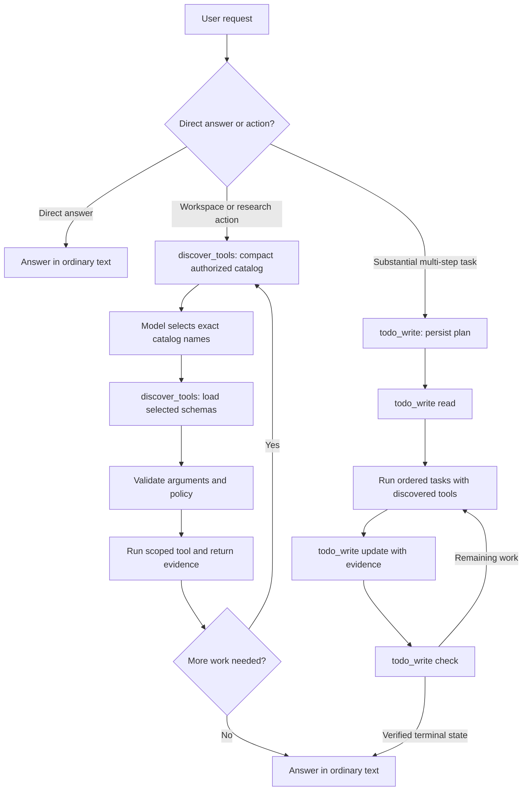

# 03. DeepSpace agent loop and tool discovery

DeepSpace gives the model a small starting interface and loads capability
schemas only when a task needs them. Tool choice is made from the request and a
live, request-authorized catalog; it is not routed through fixed prompt
keywords. The backend remains authoritative for schema validation, policy,
tenant scope, approvals, cancellation, and execution.

## Provider turn flow

`discover_tools` first returns a bounded catalog containing the names and short
descriptions of all native capabilities authorized for the current request.
The model understands the request and chooses exact catalog names; the backend
does not guess from a list of keywords. A second call loads up to eight full
schemas. An invalid name loads nothing. If a later step needs another
capability, the model repeats discovery. Only the selected schemas are sent on
subsequent provider rounds.

The initial request does not receive all native schemas. MCP tools use their
own live, conversation-scoped broker, which searches connected catalogs and
loads exact schemas by reference. Neither broker grants permissions. Each
execution still passes through the existing policy, tenant/user scope,
approval, typed or upstream schema validation, cancellation, and tool handler.

## Canonical native tools

- `read` reads the note, Library, memory, chat, or project view. For a
  Library file it supports both extracted-text reads and targeted retrieval
  queries through one schema.
- `find` searches Library files, memory, or chat history.
- `write`, `edit`, and `delete` handle authorized workspace changes.
- `analyze(operation="compare_documents")` performs exact Library document
  comparisons.
- `todo_write` owns the persisted task plan: `replace` creates or edits it,
  `read` retrieves it, `update` records status and evidence, and `check`
  verifies dependencies, blockers, and completion.
- `web_search`, `url_read`, and `image_read` support current web research.
- `sandbox_execute` and `artifact_create` support bounded analysis and saved
  outputs. `ask_user` requests required input.

Separate `document_read`, `document_query`, `document_compare`, `todo_read`,
`todo_mark`, and `todo_check` schemas are not exposed. There is no `observe` or
`final` function.
Once any required task ledger is verified, the model returns an ordinary
assistant response. The runtime does not insert a synthetic user message or a
prefilled prompt between steps.

## Planning behavior

A simple question is answered directly. For substantial work with several
independently verifiable steps, the model should persist a `todo_write` plan
before acting. `todo_write(operation="replace")` creates the plan; the same
tool reads, updates, and checks it through explicit operations. Multi-step plans require stable task IDs, execution-order task
entries, success criteria, verification methods, and valid non-cyclic
dependencies. The runtime then rereads that persisted plan, starts each ready
task, permits multiple dependent actions for the active task, records evidence,
and checks the persisted ledger before moving on. A discovery call or a prose
claim is not evidence of completed work. A blocker remains visible and does not
become a false success.

Tool schemas selected through `discover_tools` become callable on the following
provider turn. Extra calls emitted in the same selection turn are deferred, so
an undiscovered schema cannot create a false execution error. The runtime also
stops a repeated identical tool-action loop and has a bounded model-round limit.
Managed-task calls that arrive before the persisted lifecycle step is ready, or
as additional calls in an ordered turn, are returned as deferred tool results;
they are never executed early and are not presented as failed operations. The
transport boundary also de-duplicates model-facing function definitions by
name, preserving the first authorized definition. This keeps providers with a
strict unique-name requirement from rejecting a request when dynamic native and
connected-service schemas overlap.
For web research it searches first, then reads only the relevant primary pages
needed to verify the current task. During an in-progress task, a bounded group
of independent native reads can share one provider turn and run concurrently.
For example, after search results identify several primary pages, their
`url_read` calls may run together. Discovery, `todo_write`, MCP calls, writes,
questions, approvals, and calls that rely on another call's result remain
ordered and never share that batch.

The loop observes cancellation and the durable run deadline. Search count,
MCP calls, result size, provider retries, and tool execution are bounded by the
existing runtime settings. Direct conversational answers do not incur a task
plan or a forced tool round.

## Safety boundaries

Task rows are scoped by tenant, user, and DeepSpace conversation ID. Note and
Library writes use the authenticated workspace scope. Library, memory, chat,
and project reads do not expose host filesystem or shell access. Deletion is a
workspace operation and still requires clear user intent. MCP side effects
remain behind the existing approval rules.

Structured tool calls and returned results control execution; model-generated
tool markup in prose is never executed. Malformed tool arguments are rejected
before handlers run and receive at most one bounded correction retry. Completion
evidence for `todo_write` is descriptive metadata, so an oversized evidence
string is compacted to the contract's 1,000-character limit before validation;
all other fields remain strict. If correction still fails, the runtime records
the validation error and a resumable checkpoint. A retry replays only successful
tool results and asks the provider to repair the failed call, so completed work
is not repeated. Provider adapters map the same canonical OpenAI-compatible
function definitions to Google, Anthropic, OpenAI-compatible, OpenCode, and
supported local runtimes.

## Self-hosted SearXNG

The Compose files include a private `searxng` service at `http://searxng:8080`.
The API reaches it over the Compose network; it is not published to the host or
Caddy. JSON search output is enabled in `backend/searxng/settings.yml`.

Set `SEARXNG_SECRET` to a random deployment secret. The local Compose fallback
is intentionally marked for replacement in production. The provider applies
server-side timeouts, rate limits, domain restrictions, result normalization,
and SSRF protections. The model can request a search, but cannot run arbitrary
HTTP or shell commands.

## Main implementation locations

- `app/deepspace/services/native_tool_broker.py` - native catalog and exact
  schema loading.
- `app/deepspace/services/tool_registry.py` - typed native contracts and
  schema validation.
- `app/deepspace/services/mcp_tool_broker.py` - connected-service discovery,
  exact schema loading, and bounded MCP results.
- `app/deepspace/services/chat_service.py` - provider loop, task lifecycle,
  execution policy, retries, cancellation, SSE events, and verification.
- `app/deepspace/services/task_loop.py` - scoped task and note storage.
- `app/providers/services/searxng_provider.py` - server-side SearXNG client.
